# Lab6Web — Praktikum 6: JavaScript DOM dan Event Handling

Mata Kuliah: Pemrograman Web (Pertemuan 7)
Nama: Muhammad Naufal Ali Akbar
NIM: 312310687
Program Studi: Teknik Informatika, Universitas Pelita Bangsa

## Tujuan
1. Memahami DOM sebagai representasi dokumen HTML yang dapat diakses melalui JavaScript.
2. Memilih elemen dengan id, class, dan selector CSS.
3. Mengubah teks, atribut, kelas CSS, dan gaya elemen lewat JavaScript.
4. Menangani event pengguna dengan `addEventListener()`.
5. Membuat validasi form dengan pesan sesuai kondisi input.
6. Membuat halaman interaktif dengan minimal tiga fungsi yang berjalan benar.

## Struktur File
```
Lab6Web/
├── README.md
├── lab6_dom_event/           # Latihan 1–6 + Eksperimen Mandiri
│   ├── index.html
│   ├── style.css
│   └── script.js
├── mini_project_workshop/    # Mini Project: Form Pendaftaran Workshop
│   ├── index.html
│   ├── style.css
│   └── script.js
└── screenshots/              # Bukti hasil tiap latihan
```

## Cara Menjalankan
1. Unduh/clone repository ini.
2. Buka `lab6_dom_event/index.html` (latihan) atau `mini_project_workshop/index.html` (mini project) langsung di browser, atau pakai ekstensi Live Server di VS Code.
3. Buka Developer Tools → Console untuk memeriksa error.

## Langkah Kerja
| Latihan | Isi | Konsep |
|---|---|---|
| 1 | Mengubah teks judul dan paragraf | `getElementById`, `textContent` |
| 2 | Tombol menampilkan waktu klik | `addEventListener("click")`, `Date` |
| 3 | Toggle kelas `highlight` dan `teks-besar` | `classList.toggle` |
| 4 | Penghitung karakter | event `input`, `value.length` |
| 5 | Validasi form nama, email, usia | `submit`, `preventDefault`, regex |
| 6 | To-do list | `createElement`, `append`, `classList.toggle` |

### Eksperimen Mandiri
1. **Hapus item To-do** — tombol "Hapus" per item memanggil `item.remove()`.
2. **Nama minimal 3 karakter** — ditambah cabang `nama.length < 3` pada validasi Latihan 5 (juga di mini project).
3. **Event `change` pada dropdown sesi** — di mini project, sesi terpilih tampil di bawah dropdown dan di ringkasan.
4. **Sembunyikan/tampilkan paragraf** — tombol men-toggle class `.tersembunyi` (`display: none`).
5. **Script tanpa `defer` di `<head>`** — lihat jawaban di bawah.

**Jawaban Eksperimen 5.** Tanpa `defer`, browser langsung mengeksekusi `script.js` saat membaca `<head>`, padahal elemen di `<body>` belum dibuat. Akibatnya `document.getElementById("judul")` mengembalikan `null`, lalu baris `judul.textContent = ...` memunculkan error `Cannot set properties of null` di Console dan seluruh script berhenti. Solusinya: pakai `defer`, taruh `<script>` sebelum `</body>`, atau bungkus kode dengan event `DOMContentLoaded`.

### Mini Project — Form Pendaftaran Workshop
Fitur interaktif:
- Validasi nama (wajib, min. 3 karakter), email (wajib, format valid), dan sesi (wajib dipilih), dengan pesan error per field.
- Ringkasan input yang diperbarui langsung (event `input` dan `change`) serta penghitung karakter kolom harapan.
- Pesan sukses pada halaman setelah pendaftaran valid.
- Tombol "Hapus isian" untuk mengosongkan form beserta ringkasan dan pesan error.
- Tata letak responsif: dua kolom di desktop, satu kolom di layar ≤ 720px.

## Pengujian Validasi Form (Latihan 5)
| No | Skenario | Input | Hasil yang diharapkan |
|---|---|---|---|
| 1 | Semua kosong | — | "Nama wajib diisi." |
| 2 | Nama kosong | email & usia valid | "Nama wajib diisi." |
| 3 | Nama terlalu pendek | `Al` | "Nama minimal terdiri dari 3 karakter." |
| 4 | Email tidak valid | `budi@` | "Masukkan email yang valid." |
| 5 | Usia di bawah 17 | `16` | "Usia harus berupa bilangan bulat 17–100." |
| 6 | Usia desimal | `20.5` | "Usia harus berupa bilangan bulat 17–100." |
| 7 | Semua valid | `Budi`, `budi@mail.com`, `20` | "Validasi berhasil. Form siap diproses." dan form dikosongkan |

## Screenshot

### Latihan 1 — Mengubah teks dengan DOM
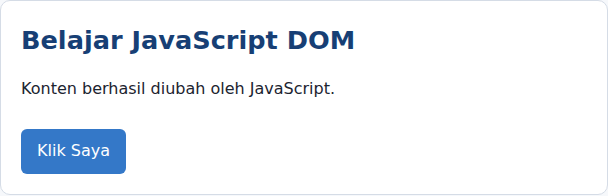

### Latihan 2 — Event click
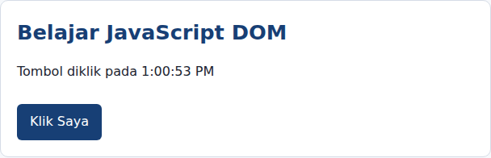

### Latihan 3 — Mengubah kelas dan gaya CSS
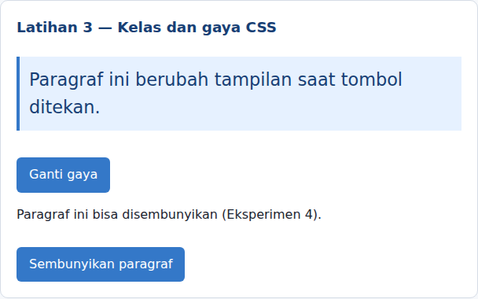

### Latihan 4 — Penghitung karakter
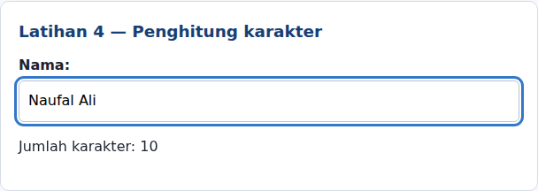

### Latihan 5 — Validasi form (7 kondisi)
| Kondisi | Screenshot |
|---|---|
| Semua kosong | 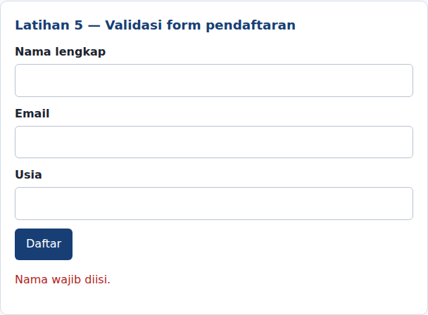 |
| Nama kosong | 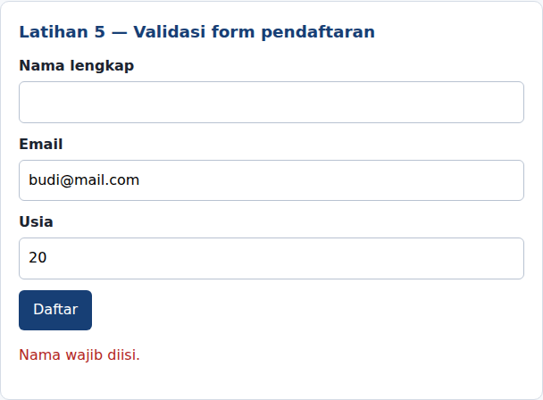 |
| Nama kurang dari 3 karakter | 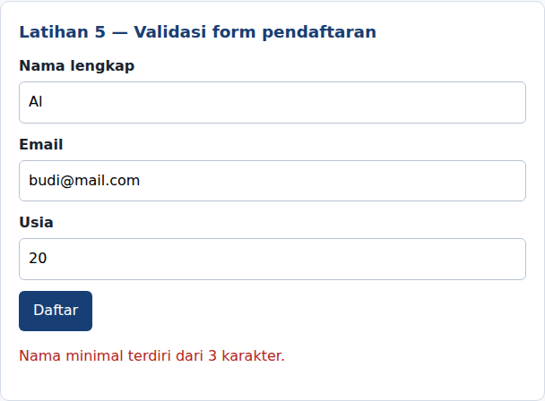 |
| Email tidak valid | 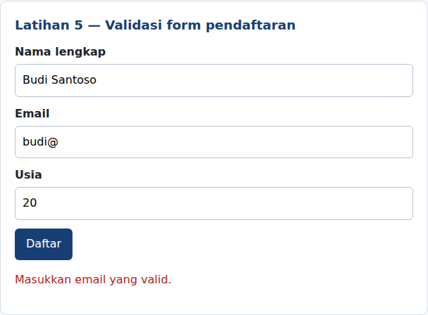 |
| Usia di bawah 17 | 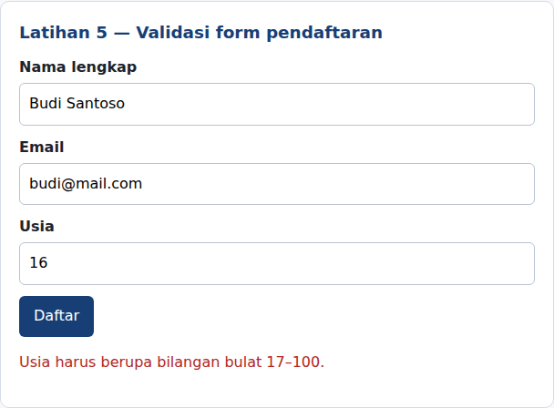 |
| Semua valid | 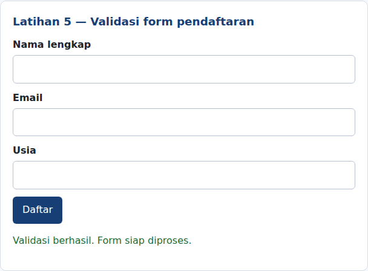 |

### Latihan 6 — To-do List
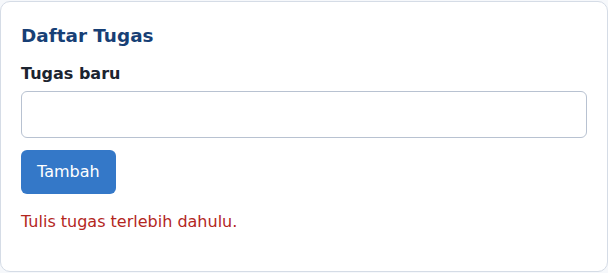
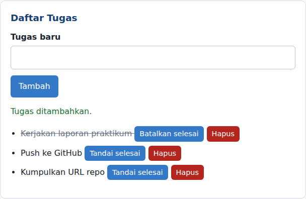

### Eksperimen Mandiri
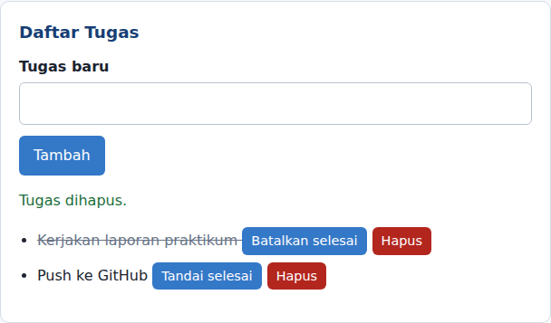
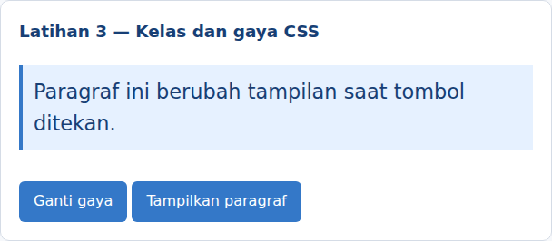
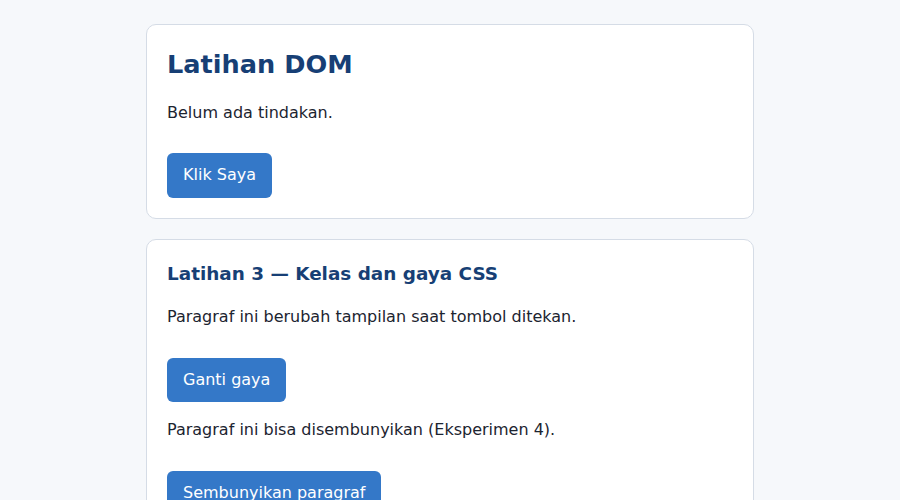

### Mini Project — Form Pendaftaran Workshop
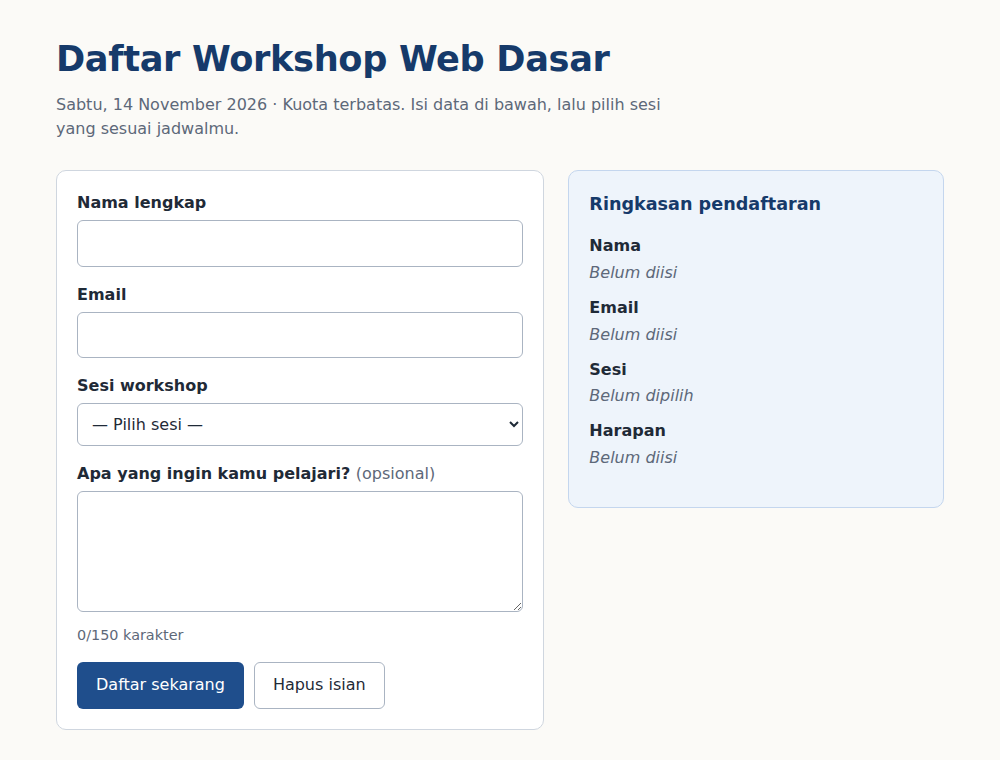
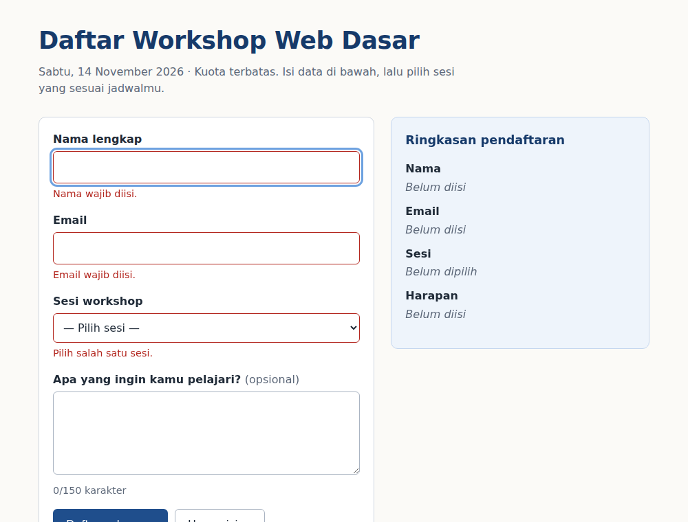
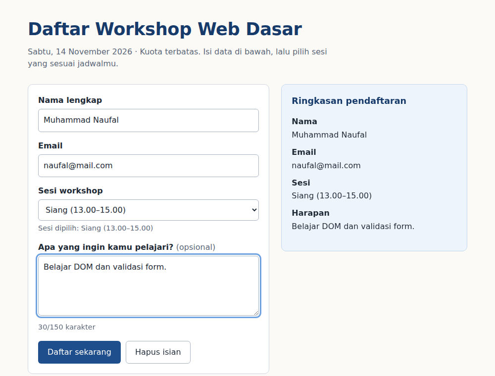
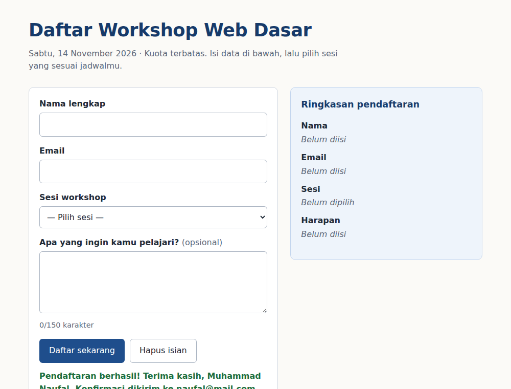
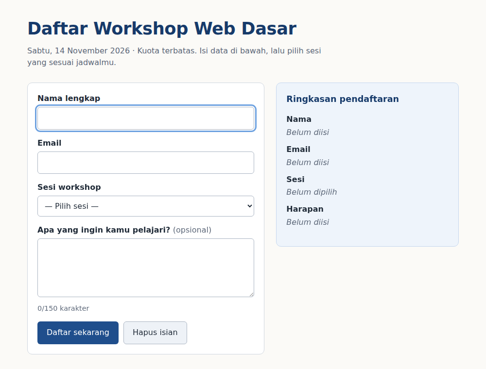
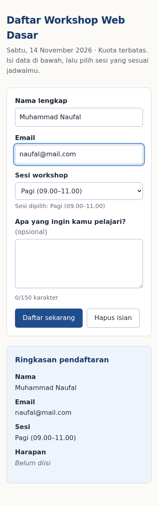

## Jawaban Pertanyaan Evaluasi
1. **DOM** adalah representasi dokumen HTML sebagai pohon objek (node) yang bisa diakses dan diubah JavaScript. Manfaatnya: memilih elemen, mengubah konten/atribut/gaya, menambah atau menghapus elemen, dan merespons aksi pengguna tanpa memuat ulang halaman.
2. `getElementById()` memilih satu elemen berdasarkan id. `querySelector()` memilih elemen **pertama** yang cocok dengan selector CSS apa pun. `querySelectorAll()` memilih **semua** elemen yang cocok dan mengembalikan NodeList.
3. `addEventListener()` menghubungkan sebuah event dengan fungsi yang dijalankan saat event itu terjadi. Contoh event: `click`, `input`, `submit` (juga `change`, `keydown`, `mouseover`).
4. `event.preventDefault()` mencegah perilaku bawaan submit, yaitu mengirim form dan memuat ulang halaman, sehingga JavaScript sempat memeriksa data dan menampilkan hasil validasi lebih dulu.
5. `textContent` memasukkan teks biasa, sehingga tag HTML tidak diurai dan aman untuk input pengguna. `innerHTML` mengurai string sebagai markup HTML, jadi berguna untuk menyisipkan struktur HTML, tetapi berisiko XSS jika memuat teks pengguna yang tidak dipercaya.
6. `classList.toggle("kelas")` menambahkan kelas jika belum ada dan menghapusnya jika sudah ada. Dengan satu tombol, tampilan elemen bisa bolak-balik berganti (misalnya highlight on/off) tanpa mengubah gaya satu per satu.
7. Skenario pengujian: (a) semua input kosong, (b) email tanpa `@` atau domain, (c) usia di luar rentang 17–100 atau bukan bilangan bulat, (d) nama kurang dari 3 karakter, (e) semua input valid.
